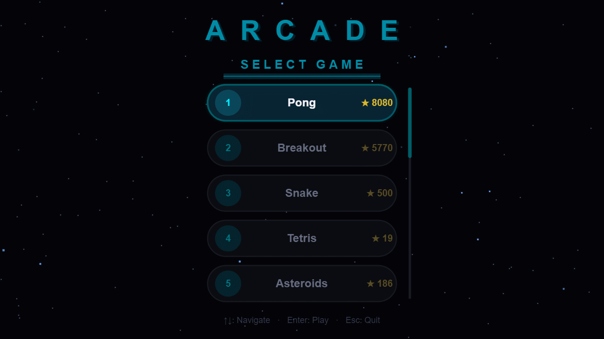
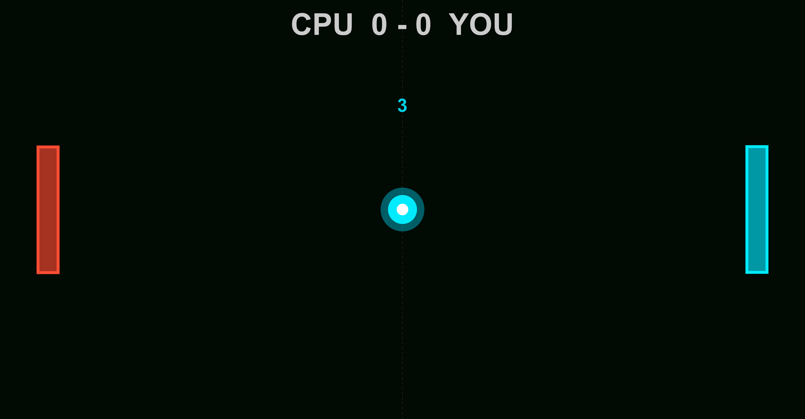
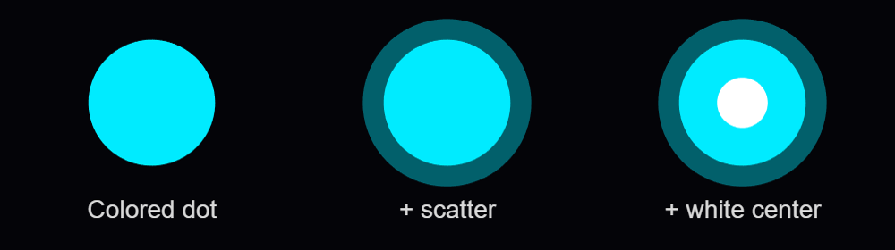
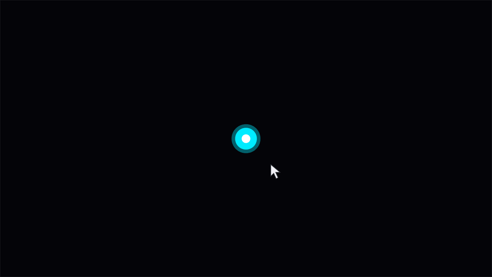
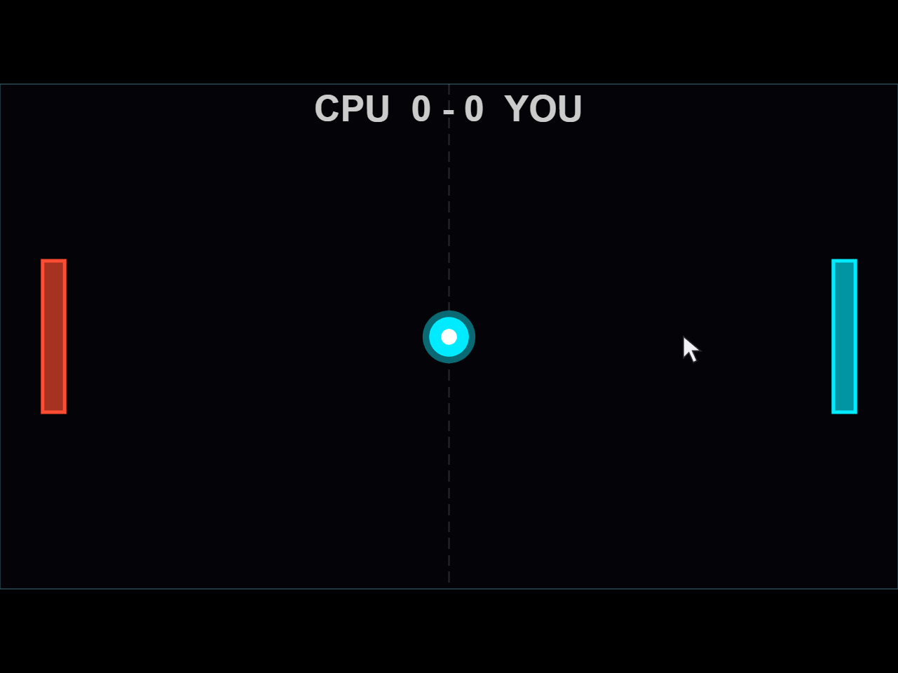
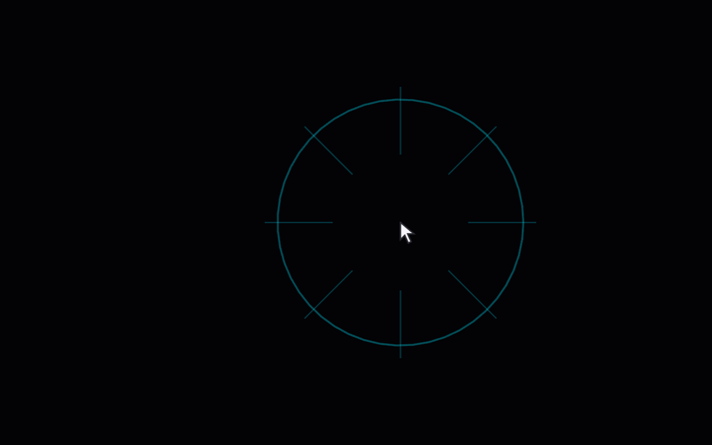
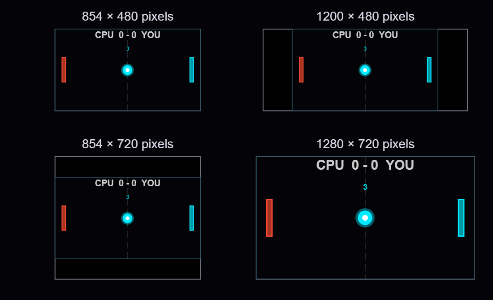
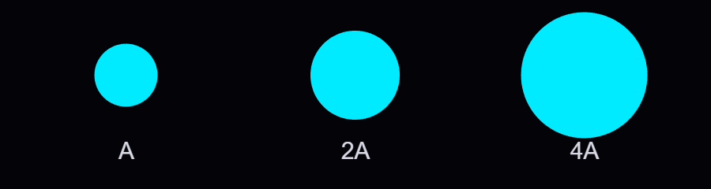
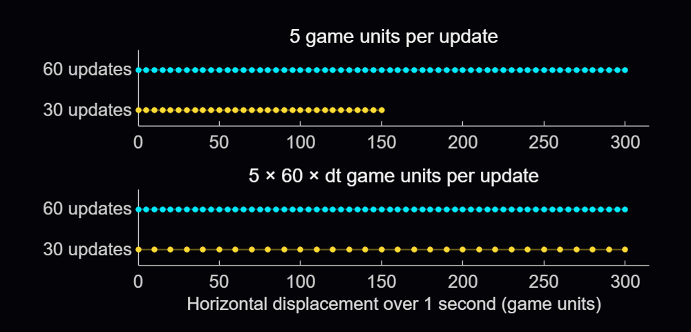

# Making games in MATLAB: Tips and tricks for the One-Button Game Mini Hack contest

The [MATLAB One-Button Game Mini Hack](https://www.mathworks.com/matlabcentral/contests/matlab-one-button-game-mini-hack.html) runs from November 2nd through November 29th, 2026! The challenge is to make a game that can be played with one button. I thought this would be a good opportunity to share some of the graphics and programming ideas behind [Arcade](https://www.mathworks.com/matlabcentral/fileexchange/183498-arcade), a collection of 15 games I developed in MATLAB using [Claude Code](https://code.claude.com/docs/en/overview) and the [MATLAB MCP Server](https://github.com/matlab/matlab-mcp-server).

Before the [2024 MATLAB Shorts Mini Hack](https://www.mathworks.com/matlabcentral/contests/2024-matlab-mini-hack.html), [Tim Marston](https://www.mathworks.com/matlabcentral/profile/authors/4596244) published his [walkthrough of Little Nemo's airship](https://www.mathworks.com/matlabcentral/discussions/tips/875587-walkthrough-making-little-nemo-s-airship-in-matlab). I learned a lot from Tim's article, and it inspired me to enter the contest. I hope that sharing some of what goes into these games might encourage a few more people to give it a try this time around as well.

<p align="center">
  
</p>

You can download Arcade from [File Exchange](https://www.mathworks.com/matlabcentral/fileexchange/183498-arcade) or [GitHub](https://github.com/Vasileios-Bellos/Arcade), add the project folder to the MATLAB search path, and run:

```matlab
Arcade();
```

You can also download the two smaller [examples](https://github.com/Vasileios-Bellos/Arcade/tree/master/demos) below and experiment with them individually.

## Creating and updating graphics

Arcade sports neon-styled graphics. This is accomplished by layering ordinary MATLAB graphics against a dark background. The bright colors used come from the shared [GameBase palette](https://github.com/Vasileios-Bellos/Arcade/blob/412f0f306e7fdc6727fb612f0de2d7e6eb25607d/%2Bengine/GameBase.m#L53), which enables the different games to keep a consistent appearance and accounts for quite a bit of that look.

In [Pong](https://github.com/Vasileios-Bellos/Arcade/blob/412f0f306e7fdc6727fb612f0de2d7e6eb25607d/%2Bgames/Pong.m#L167), the ball is made by drawing a colored dot, a semitransparent scatter marker and a smaller white dot at the same position. The ball and trail change from cyan through green, gold and red as the ball speeds up, while the center stays white. Against the dark background, these simple shapes give us the bright center and surrounding glow.

<p align="center">
  
</p>

To experiment with the ball, download [arcadeBallDemo.m](https://github.com/Vasileios-Bellos/Arcade/releases/download/v1.1.0/arcadeBallDemo.m), add its folder to the MATLAB path, and run:

```matlab
arcadeBallDemo();
```

The example creates the three layers with [`line`](https://www.mathworks.com/help/matlab/ref/line.html) and [`scatter`](https://www.mathworks.com/help/matlab/ref/scatter.html), using the playfield axes, `ax`:

```matlab
worldSize = [854, 480];
position = worldSize / 2;
cyan = [0, 0.92, 1];

radiusParameter = max(3, round(min(worldSize) * 0.035));
baseCoreSize = 2 * radiusParameter;
baseDotSize = 5 * radiusParameter;
baseGlowArea = pi * (1.25 * radiusParameter)^2;

coloredDot = line(ax, NaN, NaN, ...
    Marker=".", MarkerSize=baseDotSize, LineStyle="none", Color=[cyan, 0.15]);
glow = scatter(ax, position(1), position(2), baseGlowArea, cyan, "filled", ...
    MarkerFaceAlpha=0.4);
core = line(ax, position(1), position(2), ...
    Marker=".", MarkerSize=baseCoreSize, LineStyle="none", Color=[1, 1, 1, 1]);

ballLayers = {coloredDot, glow, core};
```

Here's how the ball looks as each layer is added:

<p align="center">
  
</p>

Setting [`NextPlot="add"`](https://www.mathworks.com/help/matlab/ref/matlab.graphics.axis.axes-properties.html) [preserves the existing graphics](https://www.mathworks.com/help/matlab/creating_plots/preparing-figures-and-axes-for-graphics.html) as we add the layers. [Specifying the axes limits](https://www.mathworks.com/help/matlab/creating_plots/change-axis-limits-of-graph.html) by using [`XLim`](https://www.mathworks.com/help/matlab/ref/matlab.graphics.axis.axes-properties.html) and [`YLim`](https://www.mathworks.com/help/matlab/ref/matlab.graphics.axis.axes-properties.html) keeps the view in place as the ball moves.

Each drawing call returns a handle to its object. With those handles stored in `ballLayers`, moving the ball involves assigning its new position to the existing objects:

```matlab
for layerIndex = 1:numel(ballLayers)
    ballLayers{layerIndex}.XData = position(1);
    ballLayers{layerIndex}.YData = position(2);
end
drawnow
```

MathWorks' [graphics-performance guidance](https://www.mathworks.com/help/matlab/creating_plots/improve-graphics-update-performance.html) recommends retaining graphics and updating the properties that change. Pong also [checks whether its scores have changed](https://github.com/Vasileios-Bellos/Arcade/blob/412f0f306e7fdc6727fb612f0de2d7e6eb25607d/%2Bgames/Pong.m#L771) before assigning new score text. Its trail uses [preallocated position buffers](https://github.com/Vasileios-Bellos/Arcade/blob/412f0f306e7fdc6727fb612f0de2d7e6eb25607d/%2Bgames/Pong.m#L136), wrapping around as new positions arrive, and two retained lines display that history as a broad dim stroke with a narrower bright stroke.

## Handling inputs using callback functions

The ball example responds to mouse presses through a [callback function](https://www.mathworks.com/help/matlab/creating_guis/write-callbacks-for-apps-created-programmatically.html). After creating the scene, it assigns a [function handle](https://www.mathworks.com/help/matlab/matlab_prog/creating-a-function-handle.html) to the figure's [`WindowButtonDownFcn`](https://www.mathworks.com/help/matlab/ref/matlab.ui.figure.html) callback property:

```matlab
fig.WindowButtonDownFcn = @reverseVerticalDirection;
```

MATLAB executes the callback function when a mouse button is pressed in the window. In the example, it is nested inside the local `animateBall` function:

```matlab
function reverseVerticalDirection(~, ~)
    velocity(2) = -velocity(2);
end
```

The two arguments supplied by MATLAB are the source object and event data. The `~` placeholders indicate that this function doesn't use them. As a [nested function](https://www.mathworks.com/help/matlab/matlab_prog/nested-functions.html), it can access `velocity` in the enclosing function. Each mouse press reverses the shared vertical velocity, which the next loop iteration uses to move the ball.

<p align="center">
  
</p>

Arcade routes input through methods on the launcher. Its figure's [`KeyPressFcn`](https://www.mathworks.com/help/matlab/ref/matlab.ui.figure.html) callback property is assigned as follows, where `obj` is the launcher instance:

```matlab
obj.Fig.KeyPressFcn = @(~, event) obj.onKeyPress(event);
```

The [anonymous function](https://www.mathworks.com/help/matlab/matlab_prog/anonymous-functions.html) forwards the event data to `onKeyPress`, where its [`Key`](https://www.mathworks.com/help/matlab/ref/matlab.ui.figure.html) property identifies the key. The launcher handles its own controls and passes appropriate input to the active game. Button release and scrolling have their own callback functions.

Mouse movement can control a paddle or aim a shot. To track the pointer as it moves within the figure, Arcade assigns a callback function to [`WindowButtonMotionFcn`](https://www.mathworks.com/help/matlab/ref/matlab.ui.figure.html):

```matlab
obj.Fig.WindowButtonMotionFcn = @(~, ~) obj.onMouseMove();
```

Here's the mouse-position tracking part of the [launcher's method](https://github.com/Vasileios-Bellos/Arcade/blob/412f0f306e7fdc6727fb612f0de2d7e6eb25607d/Arcade.m#L255):

```matlab
function onMouseMove(obj)
    pointer = obj.Ax.CurrentPoint;
    obj.MousePos = pointer(1, 1:2);
end
```

The axes' [`CurrentPoint`](https://www.mathworks.com/help/matlab/ref/matlab.graphics.axis.axes-properties.html) gives the pointer position in game coordinates. MATLAB accounts for the axes' position and size, so the same code works when the playfield is resized or surrounded by margins.

On each game update, the launcher passes the stored position to the active game's `onUpdate` method. In [Pong](https://github.com/Vasileios-Bellos/Arcade/blob/412f0f306e7fdc6727fb612f0de2d7e6eb25607d/%2Bgames/Pong.m#L242), `obj` now refers to the game instance. Once the incoming `pos` is available, its vertical coordinate determines the player's paddle position:

```matlab
yLimits = obj.DisplayRange.Y;
if ~any(isnan(pos))
    obj.PlayerPaddleY = max(yLimits(1) + obj.PaddleHalfH, ...
        min(yLimits(2) - obj.PaddleHalfH, pos(2)));
end
```

The [`min`](https://www.mathworks.com/help/matlab/ref/double.min.html) and [`max`](https://www.mathworks.com/help/matlab/ref/double.max.html) calls keep the paddle's center at least half a paddle height from either edge. Moving the pointer into a margin therefore leaves the whole paddle inside the playfield. The graphics update then applies that position to the existing paddle patches.

<p align="center">
  
</p>

The animation loop's [`drawnow`](https://www.mathworks.com/help/matlab/ref/drawnow.html) displays pending graphics changes and processes pending callbacks. Keeping callback functions short allows control to return to the loop promptly.

## Animating visual effects

When the orb is launched in Flick It!, a call to `spawnHitEffect` creates a ring and rays that expand and fade. The launcher advances these [shared effects](https://github.com/Vasileios-Bellos/Arcade/blob/412f0f306e7fdc6727fb612f0de2d7e6eb25607d/%2Bengine/GameBase.m#L258) alongside the active game.

In [arcadeEffectsDemo.m](https://github.com/Vasileios-Bellos/Arcade/releases/download/v1.1.0/arcadeEffectsDemo.m), each click creates a burst at the mouse position, allowing several bursts to expand and fade together. To try it out, download the function, add its folder to the MATLAB path, and run:

```matlab
arcadeEffectsDemo();
```

<p align="center">
  
</p>

The nested callback function combines mouse-press handling with the mouse-position tracking introduced earlier. Here's the part that creates and stores a new burst:

```matlab
fig.WindowButtonDownFcn = @createManualImpact;

function createManualImpact(~, ~)
    point = ax.CurrentPoint;
    position = point(1, 1:2);
    if any(~isfinite(position)) || any(position < 0 | position > worldSize)
        return
    end
    [newRing, newRays] = createEffect(position);
    activeEffects(end+1) = struct('Ring', newRing, 'Rays', newRays, ...
        'Center', position, 'AgeSeconds', 0, 'LastTime', toc(animationClock));
end
```

The bounds check ignores clicks outside the playfield. `createEffect` creates the lines, and `activeEffects` stores their handles, center and timing state. The animation loop updates each burst independently, allowing further clicks while earlier bursts are still expanding.

We can drive the geometry, transparency and line width from a common progress value: 0 when the burst begins and 1 at the end of its lifetime. Inside the function, the ring is updated as follows:

```matlab
progress = ageSeconds / lifetimeSeconds;
eased = 1 - (1-progress)^2;
opacity = max(0, 1-1.5*eased);
ringRadius = radiusParameter * (1+2.5*eased);

ring.XData = center(1) + ringRadius*ringCos;
ring.YData = center(2) + ringRadius*ringSin;
ring.Color = [cyan, 0.8 * opacity];
ring.LineWidth = max(0.5, 3*(1-eased));
```

The ease-out expression starts the expansion quickly and slows it down toward the end. The burst fades out before its nominal lifetime finishes. `ringCos` and `ringSin` hold the circle's fixed directions, calculated before the loop. Arcade controls the transparency of these lines by assigning an RGBA value to `Color`, with alpha as the fourth component, ranging from 0 (clear) to 1 (fully opaque).

The row vectors `rayCos` and `raySin` contain the eight ray directions. Each ray joins the inner and outer radii, which increase as the burst expands:

```matlab
innerRadius = radiusParameter * (0.5+1.5*eased);
outerRadius = radiusParameter * (1+3*eased);
for rayIndex = 1:numel(rays)
    rays(rayIndex).XData = center(1) + [innerRadius, outerRadius]*rayCos(rayIndex);
    rays(rayIndex).YData = center(2) + [innerRadius, outerRadius]*raySin(rayIndex);
    rays(rayIndex).Color = [cyan, 0.6 * opacity];
    rays(rayIndex).LineWidth = max(0.5, 2*(1-eased));
end
```

The lines are created when the burst begins, updated throughout its lifetime and deleted when it expires.

## Display scaling: Keeping the scene in proportion

Try making the ball example's window wider while keeping its height the same. Space appears beside the playfield, and the ball still travels between the same boundaries. The example's reference window is 854 by 480 pixels, matching `worldSize` numerically. Resizing scales the playfield on the screen while the game's coordinate system remains unchanged.

The figure and axes use [`Units="pixels"`](https://www.mathworks.com/help/matlab/ref/matlab.graphics.axis.axes-properties.html). Taking the [`min`](https://www.mathworks.com/help/matlab/ref/double.min.html) of the width and height ratios relative to the reference window gives the largest scale factor that fits in both directions. Applying that same scale to both dimensions preserves the playfield's 16:9 aspect ratio.

For a 1200-by-480 window, the height limits the scale to 1. The fitted area remains 854 by 480, leaving `(1200-854)/2 = 173` pixels on each side. In a 1280-by-720 window, the playfield grows to approximately 1.5 times its reference width and height. Here are four window sizes at a common page scale:

<p align="center">
  
</p>

MATLAB already scales graphics defined in data coordinates as the axes resize. For example, a paddle drawn with [`patch`](https://www.mathworks.com/help/matlab/ref/patch.html) grows with the axes. In the example, marker sizes, font sizes and line widths use points, while scatter sizes use points squared.

<div align="center">

| Quantity | Units | Resize rule |
|---|---|---|
| Positions and patch vertices | Game coordinates | Keep the coordinates; resize the axes |
| [`MarkerSize`](https://www.mathworks.com/help/matlab/ref/matlab.graphics.primitive.line-properties.html), [`FontSize`](https://www.mathworks.com/help/matlab/ref/matlab.graphics.primitive.text-properties.html), [`LineWidth`](https://www.mathworks.com/help/matlab/ref/matlab.graphics.primitive.patch-properties.html) | Points | Reference value × `displayScale` |
| Scatter [`SizeData`](https://www.mathworks.com/help/matlab/ref/matlab.graphics.chart.primitive.scatter-properties.html) | Points squared | Reference area × `displayScale^2` |

</div>

To make a circle twice as wide, we need four times its area. Doubling `SizeData` multiplies its width by only √2:

<p align="center">
  
</p>

For resizing, we assign `fitScene` to the figure's [`SizeChangedFcn`](https://www.mathworks.com/help/matlab/ref/matlab.ui.figure.html) property:

```matlab
fig.SizeChangedFcn = @fitScene;
```

The nested `fitScene` callback function combines the axes calculation with these size updates:

```matlab
function fitScene(~, ~)
    if ~isgraphics(ax)
        return
    end
    availableSize = max(fig.Position(3:4), [1, 1]);
    displayScale = min(availableSize ./ worldSize);
    fittedSize = worldSize * displayScale;
    ax.Position = [(availableSize - fittedSize)/2 + 1, fittedSize];

    % Always derive sizes from their reference values
    core.MarkerSize = baseCoreSize * displayScale;
    coloredDot.MarkerSize = baseDotSize * displayScale;
    glow.SizeData = baseGlowArea * displayScale^2;
    instruction.FontSize = baseFontSize * displayScale;
    playfield.LineWidth = 0.5 * displayScale;
end
```

The first two entries of [`ax.Position`](https://www.mathworks.com/help/matlab/ref/matlab.graphics.axis.axes-properties.html) set the left and bottom position, splitting the unused space equally between opposite sides. The last two give the fitted width and height. The axes limits remain unchanged, so movement and collision calculations keep using the same game coordinates.

At scale 1.5, the marker sizes are multiplied by 1.5 and the scatter area by 2.25. The updated sizes are calculated from their stored reference values. A 34-point reference marker becomes 51 points at scale 1.5, then 68 points at scale 2.

You can also use [`Units="normalized"`](https://www.mathworks.com/help/matlab/ref/matlab.graphics.axis.axes-properties.html) to size and position the axes relative to the figure. [Arcade's axes setup](https://github.com/Vasileios-Bellos/Arcade/blob/412f0f306e7fdc6727fb612f0de2d7e6eb25607d/Arcade.m#L223) uses `[0 0 1 1]` to allocate the full available area:

```matlab
obj.Ax = axes(obj.Fig, "Units", "normalized", "Position", [0 0 1 1]);
obj.Ax.XLim = obj.DisplayRange.X;
obj.Ax.YLim = obj.DisplayRange.Y;
```

Arcade's [resize method](https://github.com/Vasileios-Bellos/Arcade/blob/412f0f306e7fdc6727fb612f0de2d7e6eb25607d/Arcade.m#L334) obtains the available dimensions in pixels with [`getpixelposition`](https://www.mathworks.com/help/matlab/ref/getpixelposition.html) and calculates the same display scale. It uses [`pbaspect`](https://www.mathworks.com/help/matlab/ref/pbaspect.html) to preserve the playfield's aspect ratio. MATLAB fits the playfield within the available space, leaving margins where needed:

```matlab
axPx = getpixelposition(obj.Ax);
newPs = min(axPx(3) / 854, axPx(4) / 480);

gameAR = diff(obj.DisplayRange.X) / diff(obj.DisplayRange.Y);
pbaspect(obj.Ax, [gameAR 1 1]);
```

For Arcade, I also wanted markers, text and line widths to grow proportionally with the playfield. MATLAB also supports automatic resizing for text through [`FontUnits="normalized"`](https://www.mathworks.com/help/matlab/ref/matlab.graphics.primitive.text-properties.html), which expresses font size as a fraction of the axes plot box height. This works well for text in a playfield with a fixed aspect ratio. Arcade's [shared resize helper](https://github.com/Vasileios-Bellos/Arcade/blob/412f0f306e7fdc6727fb612f0de2d7e6eb25607d/%2Bengine/GameBase.m#L495) modifies current property values, using the ratio of the new scale to the previous scale; for example, moving from 51 to 68 points requires multiplying by `2/1.5`. The function applies a common display scale to text, markers and line widths, in order to preserve their relative sizes as the window is resized.


## FPS scaling: Let elapsed time determine the motion

Suppose that the ball moves 5 game units on each update. At 60 updates per second it travels 300 units in a second, but at 30 it travels only 150. Calculating the state, drawing and processing input all contribute to the time between updates, so we need to measure that interval to maintain a consistent speed.

[Gianluca Carnielli](https://www.mathworks.com/matlabcentral/profile/authors/16120437) discusses the relationship between time and animation frames in [Animating Science: Creating Time-Sensitive Animations with MATLAB](https://blogs.mathworks.com/graphics-and-apps/2024/07/19/animating-science-creating-time-sensitive-animations-with-matlab/). In his example, he explains how to create a frame-based animation from time-based coordinates, by choosing the video’s duration and frame rate, calculating the simulation timestep between two consecutive frames, and resampling the coordinates using [`retime`](https://www.mathworks.com/help/matlab/ref/timetable.retime.html).

In a live game, we process player actions and calculate each new state using the time elapsed since the previous update. Arcade expresses many motion parameters per reference interval, using 60 frames per second (FPS) as its reference frequency. An elapsed time of `1/60` seconds represents 1 reference interval, while `1/30` seconds represents 2. In the example, we define the velocity and reference frequency before the loop and start the clock with [`tic`](https://www.mathworks.com/help/matlab/ref/tic.html) once the initial scene is displayed:

```matlab
velocity = [5, 3];       % Game units per reference interval
referenceFPS = 60;       % Reference intervals per second
animationClock = tic;
previousTime = 0;
```

Each iteration measures the time with [`toc`](https://www.mathworks.com/help/matlab/ref/toc.html) and advances the position:

```matlab
currentTime = toc(animationClock);
dtSeconds = min(currentTime - previousTime, 0.1);
previousTime = currentTime;
dtScale = dtSeconds * referenceFPS;

position = position + velocity * dtScale;
```

Here `dtSeconds` is in seconds, and `dtScale` counts reference intervals. A horizontal velocity of 5 now gives a movement of 10 game units over `1/30` second. Taking 30 steps of 10 units covers the same 300 units as 60 steps of 5 units. The samples are farther apart, so the motion can look less smooth:

<p align="center">
  
</p>

The [`min(..., 0.1)`](https://www.mathworks.com/help/matlab/ref/double.min.html) caps a single represented interval at 0.1 seconds (10 FPS) to limit jumps after a stall. If an update arrives after 0.5 seconds, the code advances only 0.1 seconds, and the remaining 0.4 seconds are discarded.

The reference frequency is 60 FPS; the actual update rate depends on execution. We could also use game units per second and write `position = position + velocityPerSecond * dtSeconds`.

Arcade [schedules its updates](https://github.com/Vasileios-Bellos/Arcade/blob/412f0f306e7fdc6727fb612f0de2d7e6eb25607d/Arcade.m#L246) with a [`timer`](https://www.mathworks.com/help/matlab/ref/timer.html). The callback function assigned to its [`TimerFcn`](https://www.mathworks.com/help/matlab/ref/timer.html) property calls the launcher's frame-update method:

```matlab
obj.RenderTimer = timer(ExecutionMode="fixedSpacing", ...
    Period=0.02, TimerFcn=@(~, ~) obj.onFrame());
start(obj.RenderTimer)
```

With [`fixedSpacing`](https://www.mathworks.com/help/matlab/ref/timer.html), the period begins after the preceding callback function finishes. The function's own work therefore contributes to the interval between updates. The launcher measures the full interval and passes the resulting time scale to the active game.

The ball example uses a loop with [`pause`](https://www.mathworks.com/help/matlab/ref/pause.html). Try increasing that pause:

```matlab
arcadeBallDemo(Inf, 0.04);
```

Its measured interval includes both the pause and the surrounding work. Both Arcade and the example use the full [`drawnow`](https://www.mathworks.com/help/matlab/ref/drawnow.html) command. The [`limitrate`](https://www.mathworks.com/help/matlab/ref/drawnow.html) option can reduce rendering work by limiting display updates to 20 per second; its suitability depends on the animation's required display rate.

[Flick It!](https://github.com/Vasileios-Bellos/Arcade/blob/412f0f306e7fdc6727fb612f0de2d7e6eb25607d/%2Bgames/FlickIt.m#L336) multiplies its velocity by `friction^dtScale`, where `friction` is the fraction of velocity retained over one reference interval. Over 2 intervals, the multiplier is the square of that factor, equivalent to applying it once in each interval. This makes the velocity decay follow the elapsed time.

For accelerating objects, the numerical approximation can still change with step size, and collisions need to account for movement between samples. [Pong checks when the ball crosses the paddle's front face](https://github.com/Vasileios-Bellos/Arcade/blob/412f0f306e7fdc6727fb612f0de2d7e6eb25607d/%2Bgames/Pong.m#L318) and interpolates its vertical position there, allowing a contact to be detected between two displayed positions.

## Organizing games using classes

Arcade's registry stores a constructor function handle for each game. When a game is selected, the launcher calls the corresponding constructor to instantiate the game class. Here's an adaptation of the [launch sequence](https://github.com/Vasileios-Bellos/Arcade/blob/412f0f306e7fdc6727fb612f0de2d7e6eb25607d/Arcade.m#L853), with Pong selected explicitly and `obj` referring to the launcher:

```matlab
createGame = @games.Pong;
game = createGame();
game.FontScale = obj.FontScale;
game.init(obj.Ax, obj.DisplayRange)
game.beginGame()
obj.ActiveGame = game;
```

Each game subclasses [engine.GameBase](https://github.com/Vasileios-Bellos/Arcade/blob/412f0f306e7fdc6727fb612f0de2d7e6eb25607d/%2Bengine/GameBase.m). The shared `init` method sets up the session and calls the game's `onInit`, which creates its state and graphics. Assigning `FontScale` beforehand lets newly created markers and text use the current display size. The launcher stops its render timer before creating the game and restarts it after the initialized game is assigned to  `ActiveGame`. This prevents timer callbacks from running while the game’s state and graphics are being created.

`GameBase` declares four abstract methods that each game class must implement:

<div align="center">

| Method | Description |
|---|---|
| `onInit` | Create state and graphics for the supplied axes and world |
| `onUpdate` | Advance state and graphics using input and elapsed time |
| `onKeyPress` | Handle a key and report whether it was consumed |
| `onCleanup` | Release the game's graphics and other resources |

</div>

The launcher calls `onUpdate` on its active game, and MATLAB dispatches that call to the selected subclass. Pong implements paddle and ball movement; Flappy Bird advances its bird and pipes. All games inherit methods for scoring, combo handling and visual effects from `GameBase`. Window management, menus, timing and common services stay with the launcher.

As a [handle class](https://www.mathworks.com/help/matlab/handle-classes.html), `GameBase` lets the launcher keep a reference to the same game instance while its state changes. Position arrays, velocities, scores and graphics handles belong to that instance. [Property access attributes](https://www.mathworks.com/help/matlab/matlab_oop/property-attributes.html) allow the host to read the common score while leaving changes under the control of the game classes.

Flappy Bird creates its pipe patches in `onInit`, then reuses them throughout the game. Their handles and state are stored in private properties of the game instance. Its `onUpdate` method moves the active pipes across the playfield. Spawning a pipe selects an available pair, assigns its position and gap, and adds it to the active list. Once it leaves the playfield, the pair is hidden and its slot becomes available again:

<p align="center">
  
</p>

In the default gravity-and-flap mode, the `onKeyPress` input handler sets a pending flap flag. The next update applies the upward impulse and clears the flag.

When the window closes, Arcade [stops and deletes its timer](https://github.com/Vasileios-Bellos/Arcade/blob/412f0f306e7fdc6727fb612f0de2d7e6eb25607d/Arcade.m#L174), calls the active game's `onCleanup` method and clears its effects before deleting the figure. The smaller examples use MATLAB's [`onCleanup`](https://www.mathworks.com/help/matlab/ref/oncleanup.html) object to delete their own figure when the function exits. The `requestClose` callback function assigned to the figure’s [`CloseRequestFcn`](https://www.mathworks.com/help/matlab/ref/matlab.ui.figure.html) property sets a stop flag, letting the current update finish before cleanup removes the graphics.

## Recent work on MATLAB graphics and performance

The MathWorks graphics team has also been improving the underlying rendering system. [Maddie Moon](https://www.mathworks.com/matlabcentral/profile/authors/26618953)'s [article about WebGL](https://blogs.mathworks.com/graphics-and-apps/2025/10/20/webgl-matlabs-new-graphics-rendering-system/) describes the R2025a transition, which brought the renderer already used by [`uifigure`](https://www.mathworks.com/help/matlab/ref/uifigure.html) to regular MATLAB figures, along with work on stability, consistency and smoothing. [Will Jackson](https://www.mathworks.com/matlabcentral/profile/authors/1274477) also explains related changes to built-in panning, zooming and rotation in his [article on the new interactions system](https://blogs.mathworks.com/graphics-and-apps/2026/01/14/introducing-new-interactions-system-in-matlab-r2025a/).

R2025b focused on [quality and stability improvements](https://www.mathworks.com/products/new_products/release2025a-2025b.html), building on the changes introduced in R2025a. It also [improved performance](https://www.mathworks.com/help/matlab/release-notes.html) when capturing successive frames in a loop with [`getframe`](https://www.mathworks.com/help/matlab/ref/getframe.html), the function used by Arcade’s [recording helper](https://github.com/Vasileios-Bellos/Arcade/blob/412f0f306e7fdc6727fb612f0de2d7e6eb25607d/%2Bservices/recordGame.m#L125) to capture and store frames for GIFs and videos.

R2026a included memory and stability improvements for graphics such as scatter and surface plots, described in [Adam Danz](https://www.mathworks.com/matlabcentral/profile/authors/25613423)'s [overview](https://blogs.mathworks.com/graphics-and-apps/2026/04/27/graphics-and-app-building-updates-in-r2026a/) and the [release notes](https://www.mathworks.com/help/matlab/release-notes.html). In addition, [Jessa Karlberg](https://www.mathworks.com/matlabcentral/profile/authors/30040696) describes the [redesigned axes toolbar in R2026a](https://blogs.mathworks.com/graphics-and-apps/2026/05/04/an-accessible-modern-axes-toolbar/), which allows seamless hovering without the [animation slowdown issues](https://www.mathworks.com/matlabcentral/answers/705683-very-slow-graphics-when-mouse-pointer-moves-around-a-figure#answer_1575081) caused by the toolbar’s continuous mouse tracking in earlier releases, eliminating the need to remove the toolbar as a workaround.

R2026b improved responsiveness for large data visualizations, with [`plot`](https://www.mathworks.com/help/matlab/ref/plot.html) and [`plot3`](https://www.mathworks.com/help/matlab/ref/plot3.html) being able to display lines and markers incrementally and shortening the wait time for the first visible results. MathWorks also reports automatic selection of a dedicated rendering GPU on supported Windows and Linux systems with multiple GPUs. These changes are documented in the [release notes](https://www.mathworks.com/help/matlab/release-notes.html) and the [GPU-selection update](https://www.mathworks.com/matlabcentral/answers/2185033-how-can-i-use-a-dedicated-gpu-for-matlab-graphics-rendering-in-r2025a-and-later#answer_1576819).

You can inspect your session's default renderer and device with [`rendererinfo`](https://www.mathworks.com/help/matlab/ref/rendererinfo.html):

```matlab
info = rendererinfo;
info.GraphicsRenderer
info.RendererDevice
```

[Mike Croucher](https://www.mathworks.com/matlabcentral/profile/authors/20789457) also describes a new [object-management system for R2026b](https://blogs.mathworks.com/matlab/2026/07/14/objects-are-about-to-get-much-faster-in-matlab/), which can speed up object-oriented MATLAB code by reducing the cost of creating and deleting objects, as well as accessing their properties. The system is currently available as a beta and can be enabled through a [package on File Exchange](https://www.mathworks.com/matlabcentral/fileexchange/184335-object-performance-improvement-for-matlab-beta). Its [documentation](https://www.mathworks.com/help/matlab/matlab_oop/object-life-cycle-management.html) explains the changes to object lifecycle and compatibility.

## Developing MATLAB code with AI

Arcade was developed with [Claude Code](https://code.claude.com/docs/en/overview) through the [MATLAB MCP Server](https://github.com/matlab/matlab-mcp-server), and the [contest welcomes AI assistance](https://www.mathworks.com/matlabcentral/contests/matlab-one-button-game-mini-hack.html) as an option.

When working with an AI assistant, consider sharing your project's requirements and any existing code it can build on. Arcade's [developer guide](https://github.com/Vasileios-Bellos/Arcade/blob/412f0f306e7fdc6727fb612f0de2d7e6eb25607d/dev/README.md), for example, describes the [shared game interface](https://github.com/Vasileios-Bellos/Arcade/blob/412f0f306e7fdc6727fb612f0de2d7e6eb25607d/dev/README.md#gamebase-interface) and explains [how to add a new game](https://github.com/Vasileios-Bellos/Arcade/blob/412f0f306e7fdc6727fb612f0de2d7e6eb25607d/dev/README.md#adding-a-new-game). For your own game, you could begin with the main interaction and add features gradually, playing and improving it as you go. When something goes wrong, describe what happened and how to reproduce the problem, such as a ball passing through a wall at higher speeds.

The [MATLAB Agentic Toolkit](https://github.com/matlab/matlab-agentic-toolkit) provides workflows for code review, analysis and testing. Its [setup guide](https://github.com/matlab/matlab-agentic-toolkit#get-started-with-matlab-agentic-toolkit) covers connecting MATLAB to AI applications including [Claude Code](https://code.claude.com/docs/en/overview), [GitHub Copilot](https://docs.github.com/en/copilot), [OpenAI Codex](https://openai.com/codex/), [Gemini CLI](https://geminicli.com/docs/) and [Amp](https://ampcode.com/docs), and installing [MATLAB-specific skills](https://github.com/matlab/matlab-agentic-toolkit/tree/main/skills-catalog). Through the MCP server, the AI assistant can run MATLAB code and tests, inspect the results, and use them to help diagnose problems and revise the code.

Several implementation choices in Arcade align with the [MATLAB Coding Guidelines](https://github.com/mathworks/MATLAB-Coding-Guidelines/blob/main/MATLAB-Coding-Guidelines.md#handle-vs-value-classes) and [performance rules](https://github.com/matlab/rules/blob/main/matlab-performance-optimization.md): using a handle class for an object whose identity persists, restricting access to its state, retaining graphics, preallocating known-size arrays and cleaning up timers. The two [downloadable examples](https://github.com/Vasileios-Bellos/Arcade/tree/master/demos) presented above were checked with [MATLAB Code Analyzer](https://www.mathworks.com/help/matlab/matlab_prog/check-code-for-errors-and-warnings.html) and tested for resizing, input, handle reuse and cleanup.

I hope that this article gives you something to experiment with, and perhaps a starting point for the [One-Button Game Mini Hack](https://www.mathworks.com/matlabcentral/contests/matlab-one-button-game-mini-hack.html). I look forward to seeing what you make!

